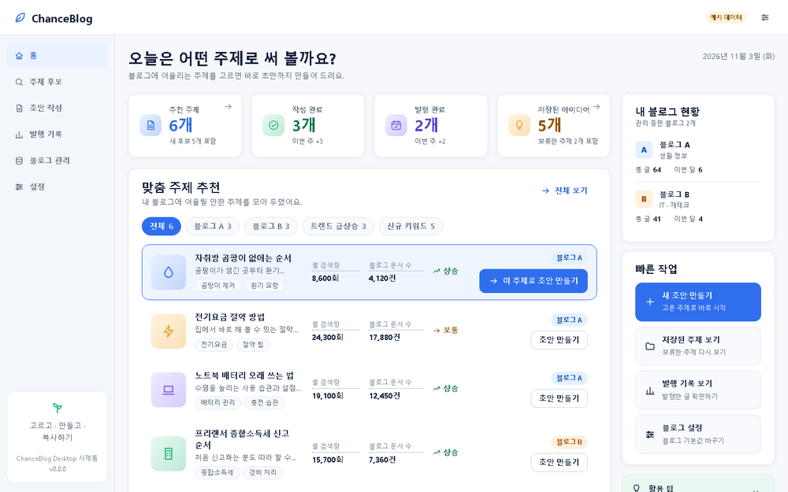
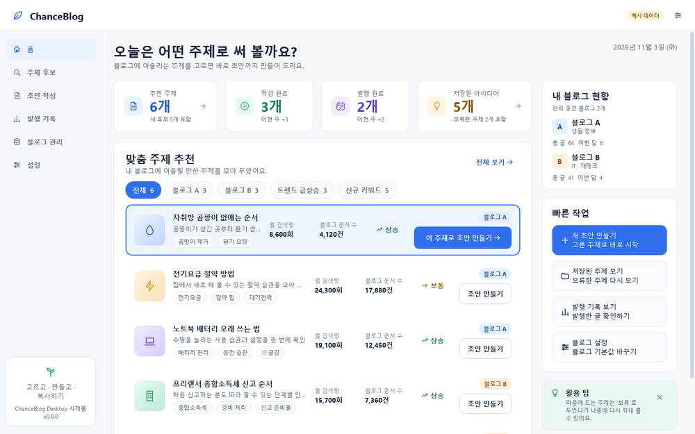
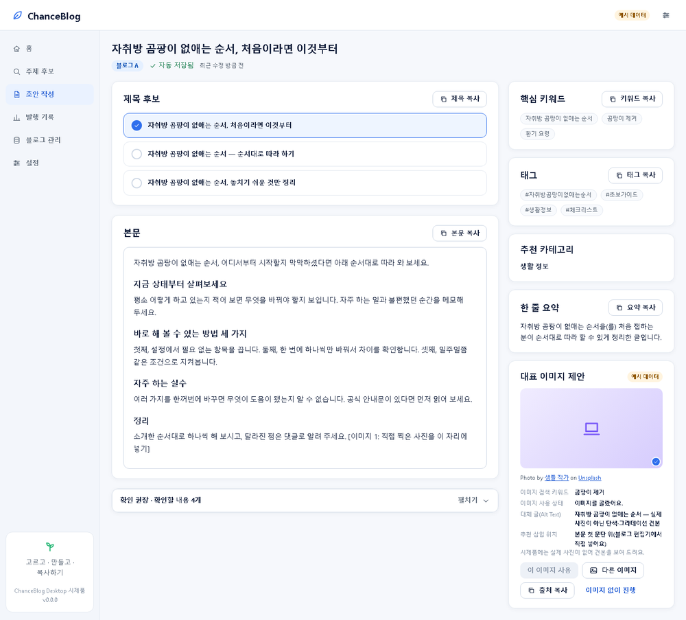
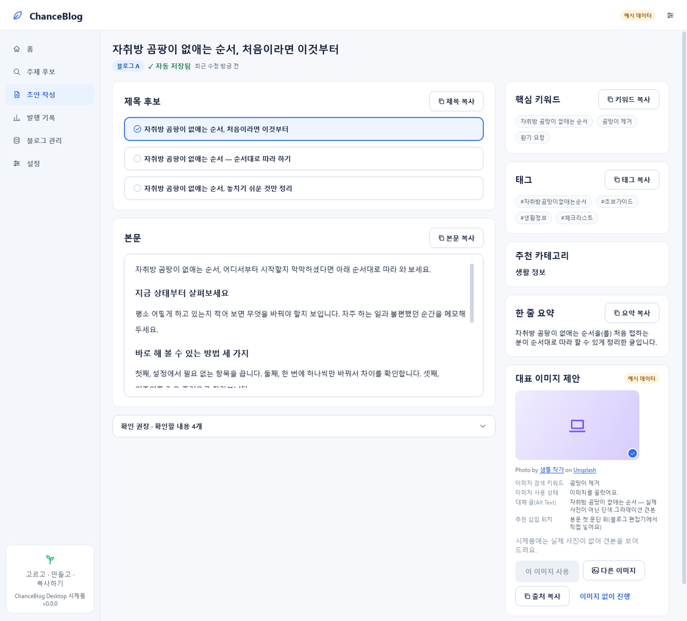
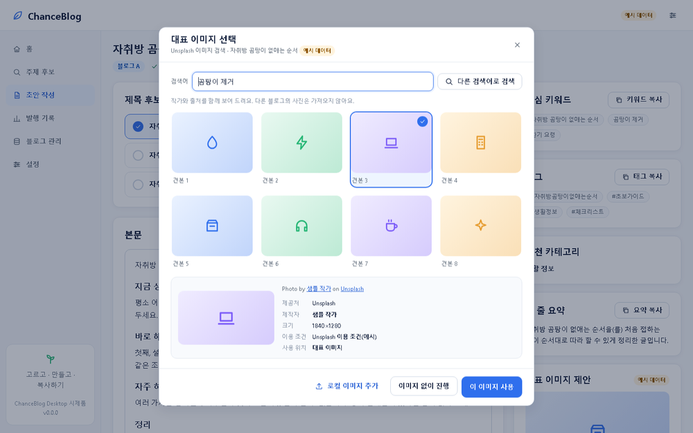
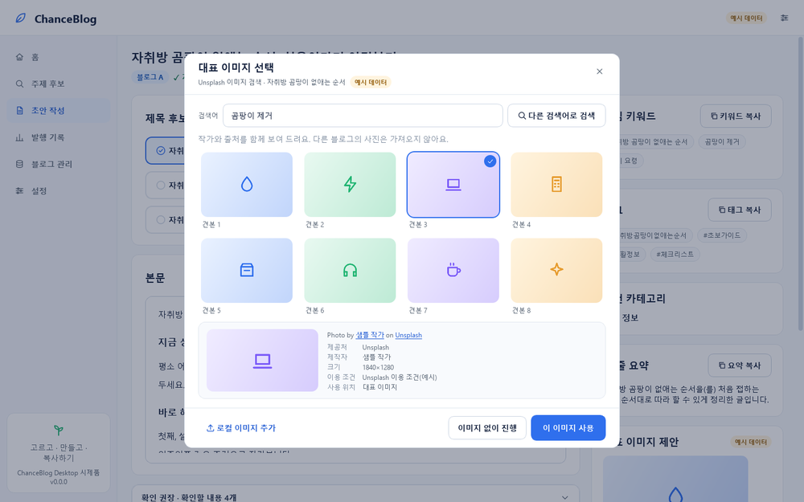
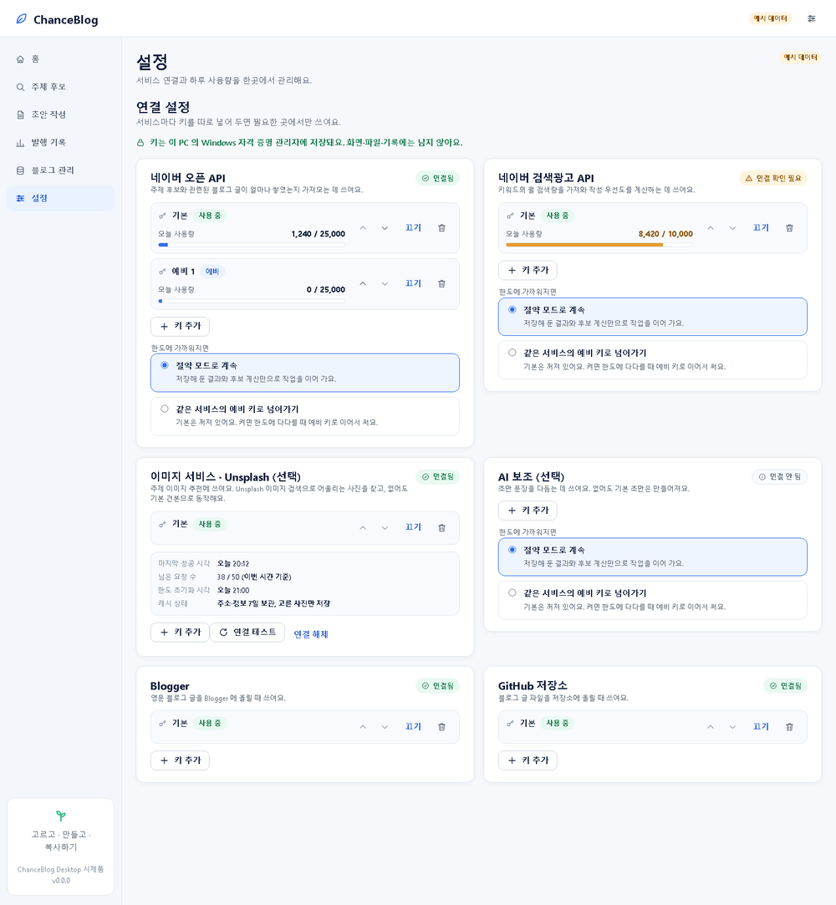
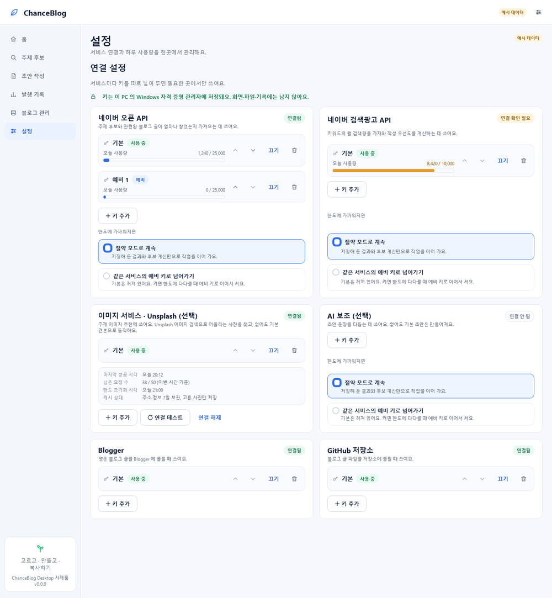

# [R-087] 화면 만드는 도구 선택 — 같은 화면을 두 도구로 만들어 비교했습니다

> **하실 일은 없습니다.** 답이 없으면 아래 **추천(기본값)** 으로 진행합니다. 바꾸고 싶은 것만 알려 주세요.
> 답하는 방법: 텔레그램의 **[답하기]** → 요청 번호 `R-087` → 답변 **승인** → **선택** 칸에 `G1=B` 처럼 적기(안 적은 항목은 기본값). 채팅으로 말씀해 주셔도 됩니다.

## 한눈에
- 올려 주신 디자인 명세(UI-SPEC v1.0.0·정밀 보완 v1.1.0)와 승인하신 목업을 기준으로, **같은 화면(홈·주제 후보·초안 결과·이미지 선택·연결 설정)** 을 두 가지 도구로 만들었습니다: **PySide6**(윈도 프로그램 도구)와 **pywebview**(웹 화면을 프로그램 창에 담는 도구). 둘 다 목업과 거의 같은 모양이 나왔고, 화면에 보이는 내용은 두 도구가 같은 부품(공용 뷰모델)을 써서 나중에 바꿔도 화면 층만 다시 쓰면 됩니다.
- **추천: pywebview(웹 화면).** 이유는 아래에 있고, 대가는 시작이 3~4초 느리고 메모리를 더 쓰며 윈도의 WebView2 가 필요하다는 점입니다.
- 시제품에는 **실제 Unsplash 사진도 실제 작가 이름도 쓰지 않았습니다**(자체 견본·가상 이름 '샘플 작가'). 인터넷·키 호출도 없습니다.

## 시제품 사진 (같은 화면, 두 도구)
**홈 화면(1440×900)**
- pywebview: 
- PySide6: 

**초안 결과 — 오른쪽 '대표 이미지 제안' 패널(`Photo by 샘플 작가 on Unsplash`·출처 복사)**
- pywebview: 
- PySide6: 

**이미지 선택 창(3~4열 Grid·선택 표시·출처·버튼 4개)**
- pywebview: 
- PySide6: 

**설정 → 연결 설정(용도별 키 입력·Unsplash 상태·사용량)**
- pywebview: 
- PySide6: 

※ 연결 설정 사진의 '같은 서비스의 예비 키로 넘어가기(기본은 꺼져 있어요)' 문구는 시제품 때 기준입니다. 보내 주신 요구사항(7~9번)에 맞춰 실제 구현에서는 **허용한 키 안에서 429·일일 한도·일시적 5xx·시간 초과일 때만 넘어가고, 401·403 같은 오류는 넘어가지 않고 조치 안내만 하며, Unsplash 에는 쓰지 않습니다**(문구와 기본값을 그에 맞게 바꿉니다).

(주제 후보 서랍·초안 복사·빈/오류/불러오는 중·한도 도달·오프라인 화면도 두 도구로 모두 만들었고, 저장소의 `docs/images/ui-after/` 에 모두 있습니다 — 병합 후 볼 수 있습니다.)

## 비교 (측정값은 대략입니다 — 이 PC 에서 다른 작업이 함께 돌았습니다)
| | PySide6 | pywebview |
|---|---|---|
| 화면 코드(공통 부품 1,045줄 제외) | 2,124줄 | 877줄 |
| 정밀 보완을 더하며 늘어난 양 | +699줄 | +233줄 |
| 만드는 데 걸린 시간(AI) | 약 40분 | 약 25분 |
| 설치 파일 재료(PyInstaller 묶음) | **98.2MB**(파일 159개) | **23.1MB**(파일 50개) |
| 첫 화면이 뜨는 시간·메모리 | **2.9초·137MB** | 4.4초·452MB(프로세스 8개) |
| 설치 없이 exe 실행 | 2.33초·149MB | 6.23초·479MB |
| 목업과의 닮음 | 높음 | 같거나 조금 더 높음(그림자·전환·키보드 툴팁) |
| 외부 필요 | 없음 | 윈도 WebView2 런타임(윈도 11·최신 10 은 대개 이미 있음) |

## 추천 이유 (pywebview) — 그리고 대가
1. 목업 충실도가 같거나 조금 더 높습니다. 2. 줄임표·툴팁·본문 폭·대화상자 같은 세부를 CSS 한두 줄로 더 빨리 맞춥니다(같은 범위가 코드 3분의 1). 3. **설치 파일이 4분의 1**(23MB 대 98MB)입니다. 4. AI 가 유지보수하기에 웹 쪽이 안정적입니다. 5. 되돌리기 쉽습니다 — 공용 부품 때문에 PySide6 로 바꿔도 화면 층만 다시 쓰면 됩니다.
**대가:** 시작이 3~4초 느리고, 메모리를 3배 정도 쓰고(약 450MB), WebView2 가 필요합니다. **개인 PC 의 메모리가 작거나(4GB 이하) 시작 속도·가벼움이 더 중요하시면 PySide6 가 맞습니다.**

## 확인 6건 (모두 기본값 있음)
**G1. 화면 도구 한 가지.**
- **A (추천·기본) pywebview** · B PySide6

**G2. 글꼴.** 시제품은 윈도 기본 글꼴(맑은 고딕·Segoe UI)입니다.
- **A (기본) 윈도 기본 글꼴로 시작**(설치 용량 최소, 나중에 바꾸기 쉬움) · B Pretendard 를 프로그램에 담기(모양이 더 일관되지만 용량·라이선스 확인이 필요)

**G3. 글자용 진한 색.** 명세의 색만 쓰면 일부 글자의 대비가 부족해, 읽기 쉬운 진한 글자색 1~2개를 더하고 싶습니다.
- **A (기본) 더해도 된다** · B 명세 색만 쓴다(대비가 낮은 곳은 그대로)

**G4. 어두운 테마.**
- **A (기본) 첫 버전에는 넣지 않는다**(색 체계만 준비) · B 첫 버전에 넣는다(일이 늘어남)

**G5. 이미지 표기 방식.** `출처 복사` 와 썸네일 줄의 작가 표기.
- **A (기본)** `출처 복사` = 문구 한 줄(`Photo by 작가 on Unsplash`)과 작가·Unsplash 링크 주소 두 줄을 함께 복사, 썸네일 줄에서는 마우스·키보드를 올릴 때 보이는 툴팁으로만 표기(선택 창·대표 이미지 패널에는 항상 표기) · B 문구만 복사 / 작은 글씨로 항상 표기

**G6. 내 사진 등록 범위와 화면 배율.**
- **A (기본)** 내 사진은 JPG·PNG·WebP 를 받고 설명 글(Alt Text)은 선택, 화면 배율 100·125% 지원, 150% 는 1920×1080 화면에서만 지원(1366×768 화면의 150% 는 지원 밖) · B 지원 범위를 더 넓힌다

## 이미 정해진 것 (다시 묻지 않습니다)
- 이미지: R-085 에서 'A 전부'로 답하셔서 그대로 진행합니다(30일 썸네일 저장은 인터넷이 될 때 Unsplash 주소 우선·같은 키 호출 예약·블로그 출처 표시 수정안·새 계정 없이 정식 방법).
- 키: 429·일일 한도·일시적 5xx·시간 초과일 때만 허용된 다음 키로 넘어가고, 401·403 등은 조치 안내만, **Unsplash 는 자동 순환 없음**(요구하신 대로 만들고 있습니다).

## 못 한 것 (운영자 PC 에서만 확인되는 것)
실제 윈도 배율 125%·150% 렌더, 실제 한글 입력기 조합, 화면 읽기 프로그램, 개인 PC 의 WebView2 유무, 승인 목업과 겹쳐 보는 검수는 이 PC 에서 하지 못했습니다(배율 흉내 사진과 보이는 창 한 번의 측정만). 정식 구현 단계의 마지막에 개인 PC 검증으로 확인합니다.

## 이어서 일어나는 일
선택(또는 기본 추천)이 정해지면 정식 화면을 **토큰·공통 부품 → 앱 틀 → 홈 → 주제 후보·서랍 → 초안 만들기·결과 → 이미지 선택 → 발행 기록 → 설정(연결 관리) → 상태 화면 → 회귀 시험** 순서로 묶음마다 독립 검증과 병합 부탁을 거쳐 만듭니다. 서비스 층(작성 기반·후보 제안·키 보관)이 먼저 병합되는 순서와 맞물려 진행하고, 마지막은 설치 마무리(16항목)입니다.

## 안 될 때
답하는 화면이 안 열리면 텔레그램의 **[사용법]** 을 보시고, 그래도 어려우면 건너뛰셔도 됩니다(기본값으로 진행).
